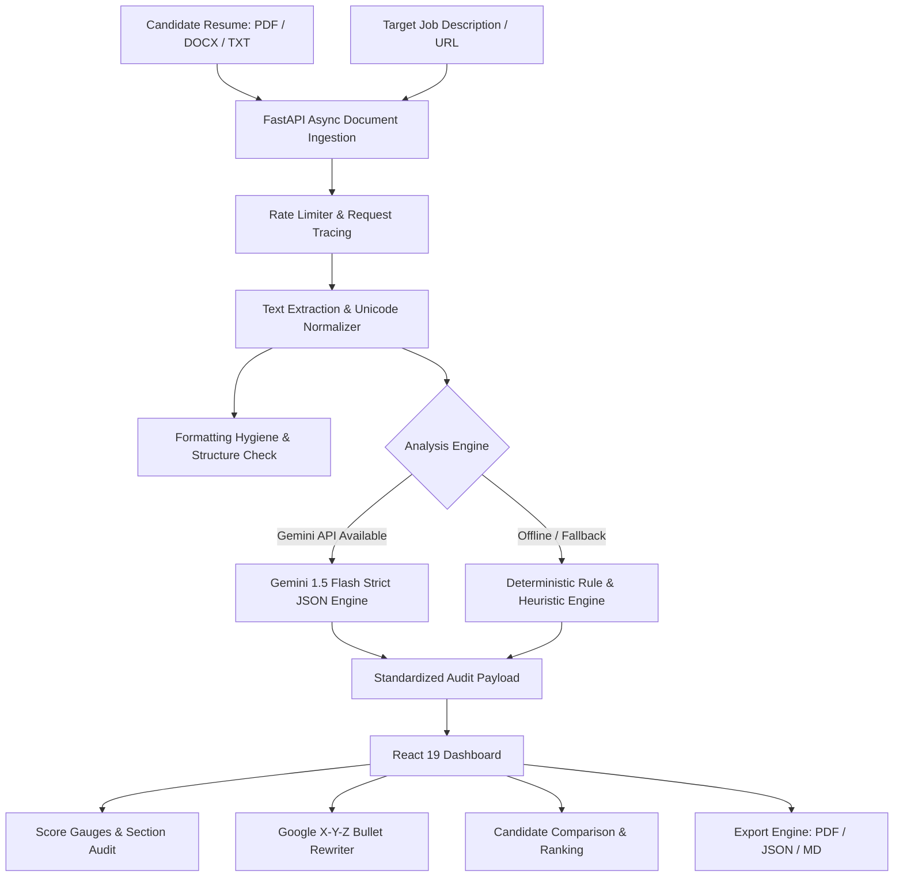

# AI Resume Analyser


An enterprise-grade resume auditing dashboard and ATS (Applicant Tracking System) compiler. It evaluates resume PDFs, DOCX, and TXT files against target job descriptions using Google Gemini AI and deterministic heuristic engines to deliver actionable feedback, keyword gap analysis, and layout compliance scores.

---

## Key Features

- **Deterministic 4-Pillar Scoring**: Scores resumes across Keywords & Skills (40%), Quantified Google X-Y-Z Impact (30%), Structural Parseability (15%), and Reading Density (15%) with executive letter grades (A+ to D).
- **Universal Multi-Industry Support**: Evaluates candidates across 16 built-in professional archetypes (Healthcare, Finance, Marketing, Sales, HR, Legal, Design, Software) with on-the-fly dynamic role synthesis for emerging or specialized careers.
- **Okapi BM25+ Lexical Retrieval**: Accurately measures keyword relevance against job descriptions while preventing keyword-stuffing exploits through term saturation limits.
- **Recursive XY-Cut Layout Linearizer**: Analyzes multi-column resumes and tables to detect column gutter collapses and prevent reading-order corruption in enterprise ATS parsers (Workday, Taleo).
- **ATS Exploit & Invisible Text Shield**: Scans documents for deceptive formatting tricks such as white-on-white text, zero-opacity fonts, microscopic text (<0.5pt), and invisible Unicode codepoints (`\u200B`).
- **Interactive Recruiter Heatmap**: Renders uploaded PDF pages directly in-browser on HTML5 canvas with simulated 6-second recruiter eye-tracking gaze paths (F-pattern/Z-pattern).
- **Verified Single-Column PDF Compiler**: Generates ATS-compliant, single-column PDF resumes with guaranteed margin clearance and lossless Unicode text layers.
- **Live Job URL Ingestion**: Headless scraping for job postings across Greenhouse, Lever, LinkedIn, Indeed, and Ashby with automated boilerplate stripping.

---

## Architecture Overview



Detailed technical specifications and design rationale are documented in:
- [System Architecture](docs/SYSTEM_ARCHITECTURE.md)
- [Architectural Pillars](docs/ARCHITECTURE_PILLARS.md)
- [API Reference](docs/API_REFERENCE.md)
- [Development Roadmap](docs/ROADMAP.md)

---

## Tech Stack

| Layer | Technology | Purpose |
|---|---|---|
| **AI Inference** | Google Gemini 1.5 Flash | Structured ATS auditing, keyword gap analysis, feedback |
| **Backend API** | FastAPI + Uvicorn | Asynchronous REST API, CORS middleware, routing |
| **Document Processing** | PyPDF + python-docx | Text layer extraction, ligature decomposition, layout tokens |
| **Security & Rate Limiting** | SlowAPI | IP-based request throttling and DoS mitigation |
| **Frontend Framework** | React 19 + Vite | Glassmorphic dark dashboard, interactive visualizer |
| **PDF Rendering** | PDF.js (`pdfjs-dist`) | Canvas-based PDF viewer and recruiter eye-tracking overlays |
| **Testing** | Pytest + Vitest | 540+ automated unit and integration tests |

---

## Quickstart

### Prerequisites
- **Python**: 3.10 or higher
- **Node.js**: 18+ (LTS recommended)

### 1. Backend Setup
```bash
cd backend

# Create and activate virtual environment
python -m venv .venv
# Windows (PowerShell):
.venv\Scripts\Activate.ps1
# macOS/Linux:
source .venv/bin/activate

# Install dependencies
pip install -r requirements.txt

# Configure environment variables
cp .env.example .env
# Edit .env and set GEMINI_API_KEY (optional; offline heuristic engine runs if omitted)

# Start API server
uvicorn app.main:app --host 0.0.0.0 --port 8000 --reload
```
The API is available at `http://localhost:8000` with interactive Swagger docs at `http://localhost:8000/docs`.

### 2. Frontend Setup
```bash
cd frontend

# Install npm packages
npm install

# Start Vite development server
npm run dev
```
The dashboard will open at `http://localhost:5173`.

---

## Running Tests

Run the full automated test suite (540+ test cases covering parsers, compliance, security, and multi-industry support):

```bash
# Backend test suite
cd backend
pytest tests/ -v

# Frontend test suite
cd frontend
npm test
```

---

## Project Structure

```
AI-RESUME-ANALYSER/
├── backend/
│   ├── app/
│   │   ├── routers/        # Modular API endpoints (analysis, audits, bullets, tools)
│   │   ├── simulators/     # Multi-vendor ATS emulation (Workday, Taleo, Greenhouse)
│   │   ├── analyzer.py     # Gemini AI orchestration and heuristic fallback
│   │   ├── compliance.py   # Deterministic 4-pillar scoring engine
│   │   ├── keywords.py     # Dynamic N-gram & domain keyword matcher
│   │   ├── parser.py       # PDF/DOCX extraction and Unicode normalization
│   │   └── role_readiness.py # Universal multi-industry role matrix
│   └── tests/              # 540+ pytest automated test cases
├── frontend/
│   ├── src/
│   │   ├── components/     # React dashboard components & PDF canvas viewer
│   │   ├── App.jsx         # Main application container
│   │   └── index.css       # Glassmorphic dark styling system
│   └── package.json
├── docs/                   # Architectural blueprints, API docs, and roadmap
├── Dockerfile              # Multi-stage container build
├── docker-compose.yml      # Local container orchestration
└── README.md
```

---

## License

This project is licensed under the [MIT License](LICENSE).
